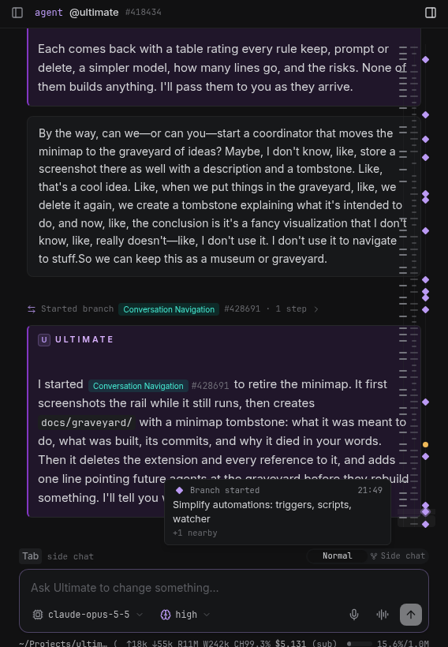
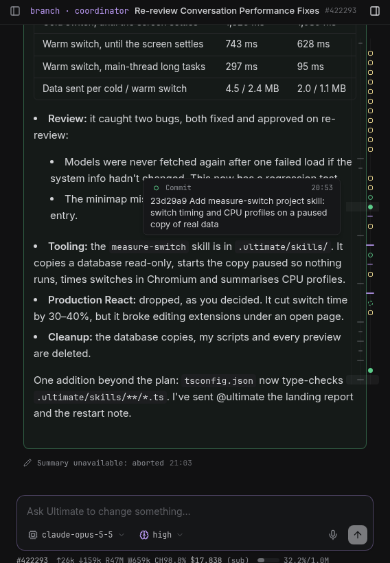

# 🪦 Conversation minimap

**Born and buried 2026-10-27.** Built in #418571, removed in #428691.




## The idea

A fast-navigation rail beside the transcript's scrollbar: one mark per thing that happened in a conversation, shaped
and coloured by kind (branches, landings, commits, previews, messages), so a long conversation could be skimmed and
jumped through without scrolling. Which milestones mattered was meant to depend on the kind of conversation:
@ultimate cares about branches and landings, a coordinator about commits, previews and submissions.

## What was built

The `minimap` extension, about 700 lines (`web.tsx` 433, `server.ts` 122, `marks.ts` 118, plus refs, README and a
46-line test):

- **Lanes rail**, chosen in a preview round over two other variants: three thin lanes (you · the agent · milestones)
  in a 48 px column on the right of the transcript, hidden on phones. A shaded band showed which marks were on screen.
  Hover or the mouse wheel stepped through marks with a tooltip (kind, time, text, "+N nearby"); click or Enter
  jumped there through the core `ultimate:reveal-entry` event, loading older history when needed.
- **A whole-conversation `minimap.marks` action** that classified the conversation's history once without a model,
  then read only new entries on later calls, and placed each `coding-tools.committed` commit at the bash call that made
  it.
- **A classifier** (`marks.ts`) for user inputs and messages, the last answer of each turn, other agents' messages,
  branch and subagent starts and reports, previews, screenshots, submissions, landings and failures, restarts and
  compactions, with a milestone lane chosen by conversation role (@ultimate, coordinator or worker).
- **Merged slots**: marks were spaced by order, not time; when more marks than pixels, neighbours packed into one
  slot, each lane's glyph still its own click target.

## Commits

- `6ead15e` mock rail with three interaction variants (preview round 1)
- `896770e`, `71b1373`, `59d2488` lint, and stopping the scroll tracker from re-rendering in a loop
- `cb72f59` lanes rail over real marks from the whole-conversation marks action
- `cb3a662` per-glyph targets, commits on visible rows, commits refreshed on their own (landed)
- `5aaaf0a`, `08f9fbd` later: a conversation-switch performance round made the rail fetch marks once per switch and
  follow a conversation's first entry. Those commits' store and composer changes are general and stay.

## Why it died

The user's verdict, a few hours after it landed: it's a fancy visualization that they don't use to navigate to stuff.
Scrolling, search and the transcript's own cards already got them where they wanted; the rail cost a column of
screen, a fetch per conversation switch and code to maintain, without changing how anyone moved through a
conversation.

## Bringing it back

Everything lives in one extension folder, so restoring it is a checkout of the last version:

```sh
git checkout 08f9fbd -- extensions/minimap test/minimap.test.ts
```

or revert the removal commit (`git log -- docs/graveyard/minimap` finds it). It depended only on the core
`ultimate:reveal-entry` event and the `coding-tools.committed` event; check that both still exist. Before reviving it,
have an answer to why it would be used this time.
